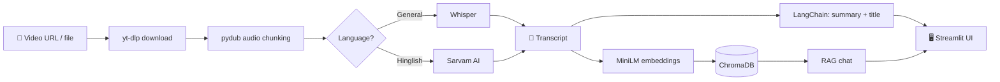

<div align="center">

# 🎬 Video Agent

**Turn any video into a transcript, a summary and a chat you can ask questions to.**


</div>

---

## ✨ What it does

Paste a video link or upload a file, and Video Agent will:

- 🎧 **Download and prepare** the audio (yt-dlp + pydub chunking)
- 📝 **Transcribe** it with Whisper, or Sarvam AI for **Hinglish** content
- 🧾 **Summarize** it and generate a clean **title** using an LLM (Gemma)
- 🔎 **Index** the transcript in a local ChromaDB vector store
- 💬 **Chat with the video**: ask questions and get answers grounded in the transcript (RAG)

## ⚡ Performance

| Input | End-to-end time |
|-------|-----------------|
| 21-minute video | **~3 minutes** (download, transcription, summary, indexing) |

Whisper and the Gemma LLM run on Google Colab and are exposed to the app through an ngrok tunnel, so no paid API is required.

## 🧠 How it works



## 🛠️ Tech stack

| Layer | Tools |
|-------|-------|
| Language | Python |
| Audio | yt-dlp, pydub |
| Speech to text | Whisper, Sarvam AI (Hinglish) |
| LLM | Gemma via Ollama (hosted on Google Colab) |
| RAG | LangChain, ChromaDB, all-MiniLM-L6-v2 embeddings |
| Interface | Streamlit |

## 🚀 Getting started

**1. Clone the repo**
```bash
git clone https://github.com/itsudit2003/video-agent.git
cd video-agent
```

**2. Create a virtual environment and install dependencies**
```bash
python -m venv .venv
.venv\Scripts\activate        # Windows
# source .venv/bin/activate   # macOS / Linux
pip install -r requirements.txt
```

**3. Add your configuration**

Create a `.env` file in the project root:
```env
SARVAM_API_KEY=your_sarvam_key
NGROK_WHISPER_URL=https://your-whisper-tunnel.ngrok-free.app
NGROK_LLM_URL=https://your-ollama-tunnel.ngrok-free.app
```

**4. Run the app**
```bash
streamlit run app.py
```

> 💡 **No Colab?** Whisper can also run locally as a fallback, though it will be slower on CPU.

## 🗺️ Roadmap

- [x] Video to transcript, summary and title
- [x] RAG chat over the transcript
- [x] Streamlit interface
- [ ] Save chat sessions
- [ ] History of previously processed recordings
- [ ] Scale to larger libraries of videos

## 👤 Author

**Udit Sood**
